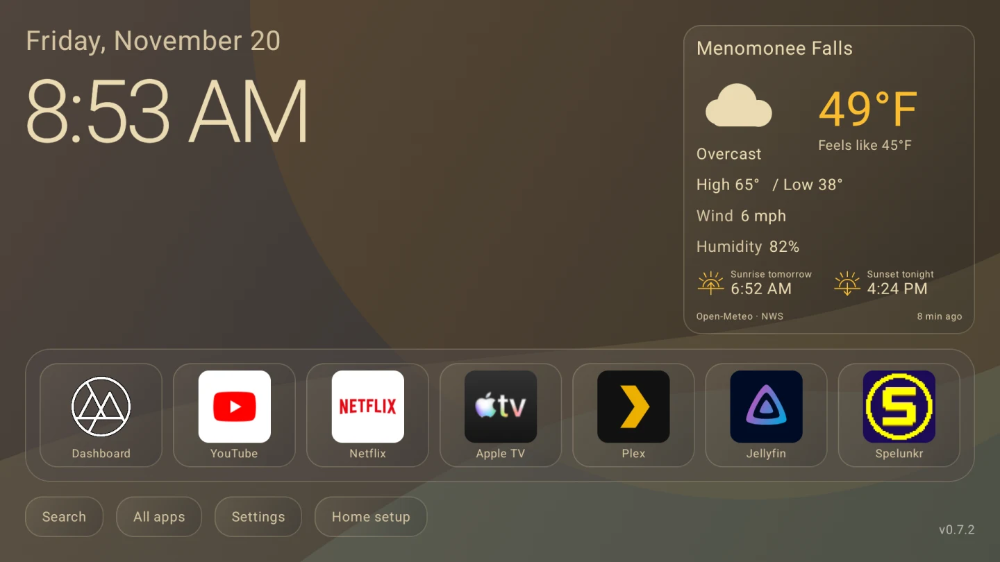
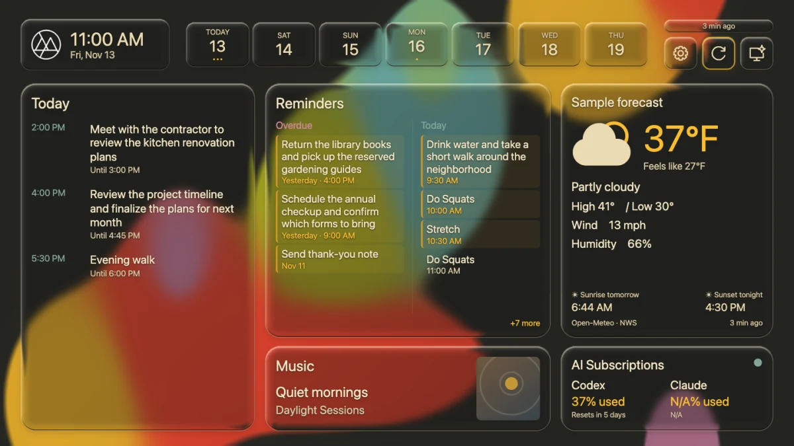
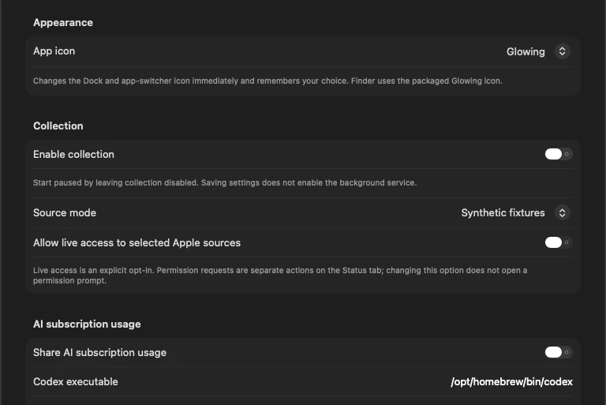
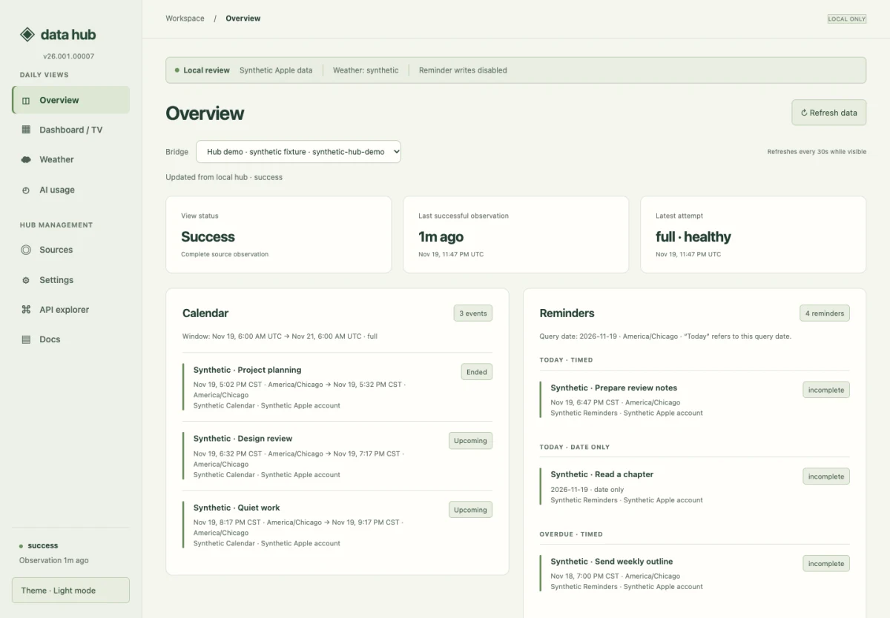

I started with two things I wanted from my Chromecast. I wanted an ad-free home screen that put my apps within a few remote clicks, and I wanted to see my week from the couch. For the first part, everything I needed was already installed on the TV. For the second, the TV needed to show calendar and reminder data that lived on my Mac. That difference shaped just about every decision that followed.

## Getting something on the TV

I used HTML mockups to try different launcher layouts before building KMA Home in Kotlin and Compose for TV. I settled on a dock that puts Dashboard first and uses a visible focus target to show what the remote will open. I kept the dashboard independently launchable. That let me change how I viewed my week while keeping the launcher’s job simple.

_KMA Home running on the living room Chromecast._

Then I started pressing buttons. The launcher briefly focused Weather before landing on Dashboard, a jump the emulator could reproduce. I revised the focus-entry rule to select Dashboard directly and checked the trip up to Weather and back from its dialog. The same exercise made me think about what happens when I leave the apps. I changed both to release their Compose screens, including artwork and animated textures, when they stop, while saving enough state to restore focus on return.

I adapted Week Canvas to fit a TV. A seven-day strip lets me choose a day, and the main view shows the agenda, reminders, weather, and music. I revised the ordering after seeing how it felt in use. An event still in progress belongs in the agenda, with the same gold accent as an overdue reminder. All-day events stay at the top. The agenda and reminder cards measure wrapped titles so a particularly long item doesn’t leave half a row sticking out at the bottom.

_The Week Canvas design prototype with sample data._

## Working out where the data belonged

The Mac already had access to the Apple data, so I built **Apple Bridge** to collect it there. The Swift settings app lets me choose calendars and reminder lists. A background worker managed by a per-user LaunchAgent collects the selected data through EventKit and keeps running after the window closes. The worker saves a pending snapshot and retries the delivery until it gets a matching acknowledgment. It reads Codex quota through a separate local interface, with its own schedule and data contract.

_Apple Bridge collection settings in fixture preview mode._

I built **Dashboard Data Hub** in Python with FastAPI, Pydantic, and SQLite. It validates the bridge’s versioned snapshots and stores each complete set of facts together with its source revision. The TV can read from the hub even if the Mac is asleep. The hub’s own web view gave me another place to look at the same data, which mattered when I needed to tell whether a display bug started on the TV or further upstream.

_Dashboard Data Hub running with synthetic data._

The first end-to-end lesson was that a successful fetch can still carry old or incomplete data. I split the hub’s latest collection attempt from its last complete observation. If a new attempt is partial, the dashboard can keep showing the previous complete view with its original source age. I separated that age from the TV’s fetching indicator too. Otherwise, every successful poll made the same old information look new again.

## Following the failure upstream

The first live calendar export arrived marked partial. Apple Bridge could read the selected calendars, so I looked at the conversion step. I’d expected all-day events to end at midnight on the next day. Modern EventKit can return the final second of the event’s last day. I matched that documented form to the hub’s exclusive end date by moving to the next local calendar-day boundary. I tested the conversion across daylight-saving transitions, when a fixed 24-hour adjustment would give the wrong answer. After installing the fix, a normal scheduled observation reported full coverage for the selected sources. [Apple’s EventKit technote](https://developer.apple.com/documentation/technotes/tn3130-changes-to-eventkit-in-macos13-ventura)

Weather prompted a different kind of revision. I’d started with collection in the TV apps. I moved it into the hub so the launcher and dashboard could read the same forecast and alert publications per location. Both apps can keep a cached copy, and I checked the shared feed on both TVs. When the production city search broke, I followed the request through the reverse proxy and found it was stripping a header the weather page needed. I fixed the forwarding and covered the request in a regression test.

## The bug that survived the first fix

Music takes a shorter route. The AirPlay receiver runs on the TV, where KMA Dashboard can read the track, artwork, and position. On a live stream, I saw the timer freeze while audio kept playing. Position updates from the sender were sparse, so I adapted ScreenDock to advance its estimate using incoming audio packet timestamps between updates.

The missing first cover was trickier. A song could come through with a title and artist and no artwork until I changed tracks. A receiver trace showed the phone had sent the cover. Duplicate metadata could make ScreenDock reject an image still decoding as stale. I fixed that order, then tried reconnecting on the bedroom TV and got a blank cover again. On the second trace, the cover had arrived before the first track metadata, which invalidated the pending decode.

I revised the receiver to treat the first cover and first meaningful metadata as part of the same track. A real track change or disconnect still invalidates old work. I added regression coverage for the different callback orders and tried a fresh AirPlay connection on the bedroom TV. This time the first cover loaded and the timer advanced without a track change.

## Making the round trip

The system now has a readable path from **Apple Bridge → Dashboard Data Hub → KMA Dashboard**. The Mac observes, the hub validates and stores, and the TV renders the cached view with its source age. Weather starts at the hub and feeds both TV apps. Music comes straight from the receiver.

Completing a reminder goes the other way in configurations where I enable that action. The TV sends the exact item and the snapshot revision I saw. The hub queues it, and the Mac checks the accepted version, applies the change through EventKit, and reads it back. That gives the TV enough information to show whether an action is queued, confirmed, or in conflict. The ordinary TV connection only reads data.

I used Codex throughout to coordinate work across the three repos. I gave agents bounded jobs in research, implementation, and review, with an expected result I could check. I used mockups to compare designs and kept decisions and device observations with the code so later sessions could pick up the investigation. The artwork bug is the example I keep coming back to. The first patch and its tests covered a real defect. The reconnect on the TV gave me a new observation that changed the diagnosis. The three projects came together through a series of those checks, from an awkward move on the remote to a partial snapshot on the hub.

[View the KMA-Chromecast project](/projects/kma-chromecast/).
